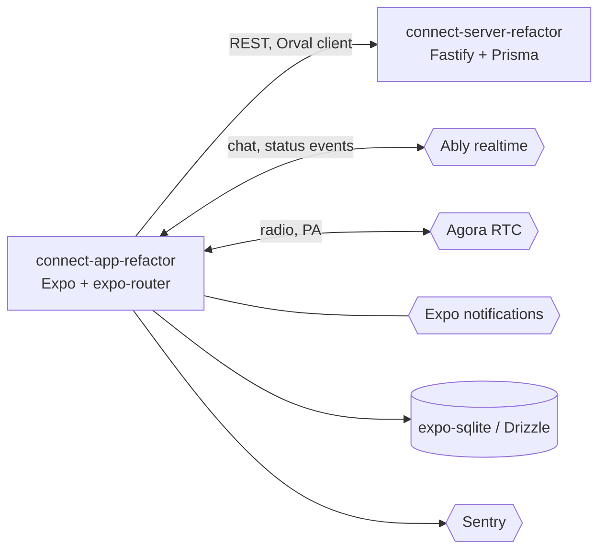

# Connect App

Expo mobile app for ambulance crews and base operators: chat, push notifications and radio / public-address calls over a multi-tenant fleet communications platform.

**Status:** prototype / work in progress, not presented as production. It cannot run end to end from this repository set alone: the realtime (Ably token) and radio (Agora token) endpoints it calls are not in `connect-server-refactor` (see "Known gaps").

## What it does

- Sign-in against the REST API and an onboarding flow for contacts and activities (`src/pages/onboarding`).
- Chat with realtime delivery over Ably (`src/services/use-ably.ts`, `src/pages/chat`).
- Radio and public-address calls over Agora (`src/services/use-agora.ts`, `src/hooks/use-radio-call-handler.ts`).
- Local notifications and a foreground service plus a background-connection plugin to keep the realtime link alive (`src/services/use-foreground-service.ts`, `src/hooks/use-background-service.ts`).
- Offline storage with SQLite and Drizzle (`src/services/database`, `drizzle/`).
- Error reporting with Sentry.

## Architecture



- Routing is file based (`app/`, expo-router) with `public` and `protected` groups.
- The REST client is generated by Orval from the server's `swagger.json` and goes through one Axios instance (`src/lib/api.ts`).
- Realtime and radio use short-lived tokens issued by the backend; the phone then talks to Ably and Agora directly.

## Key engineering decisions

- Contract-first API client: `orval.config.ts` reads `../connect-server-refactor/swagger.json` and emits typed React Query hooks, so server changes surface as type errors.
- Environment validated at boot with zod (`src/env/index.ts`); the app refuses to start on missing variables.
- Offline-first local store with Drizzle migrations checked in (`drizzle/`).
- Styling with NativeWind (Tailwind classes in React Native).

## Known gaps

- No automated tests and no CI.
- The generated client (`src/http/generated`) is git-ignored and must be produced locally.
- `package.json` points `expo-background-connection-plugin` at a local filesystem path that is not in this repository, so `yarn install` fails until it is replaced.
- Realtime and radio token endpoints live outside this repository set.

## Tech stack

Expo 54, React Native 0.81, expo-router, NativeWind, TanStack Query, Orval, Axios, Ably, react-native-agora, expo-sqlite + Drizzle, Sentry, zod.

## Getting started

Prerequisites: Node 20+, Yarn, Android Studio or Xcode, the `connect-server-refactor` repo cloned next to this one.

```bash
cp .env.example .env     # fill placeholders
yarn install
npx orval                # generates src/http/generated from the server swagger.json
npx expo run:android     # or run:ios
```

| Variable | Purpose |
|---|---|
| `EXPO_PUBLIC_BACKEND` | Base URL of the REST API |
| `EXPO_PUBLIC_STORAGE_URL` | Public base URL of the object storage |
| `EXPO_PUBLIC_APP_VERSION` | Version string shown and sent by the app |
| `EXPO_PUBLIC_SENTRY` | Sentry DSN |
| `EXPO_PUBLIC_AGORA_APP_ID` | Agora project identifier |

## Testing

None yet. Lint with `yarn lint`.

## Project structure

```text
app/        expo-router screens (public, protected)
src/        components, hooks, services (Ably, Agora, database), pages, lib
drizzle/    SQLite migrations
assets/     images and fonts
```

## Related repositories

The Connect family:

- [connect-server-refactor](https://github.com/mkwitko/connect-server-refactor) - REST API
- [connect-dashboard-refactor](https://github.com/mkwitko/connect-dashboard-refactor) - web operator dashboard
- [connect-app-refactor](https://github.com/mkwitko/connect-app-refactor) - this app
- [connect-driver-app](https://github.com/mkwitko/connect-driver-app) - driver mobile app
- [connect-comms-app](https://github.com/mkwitko/connect-comms-app) - communications-only mobile app

## License

All rights reserved. Source available for portfolio review.
