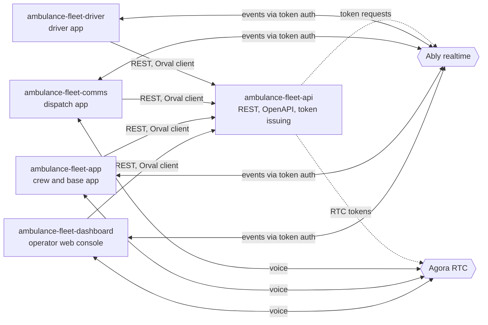
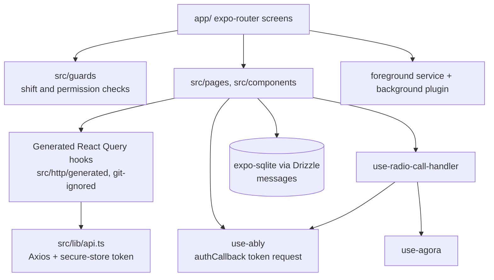
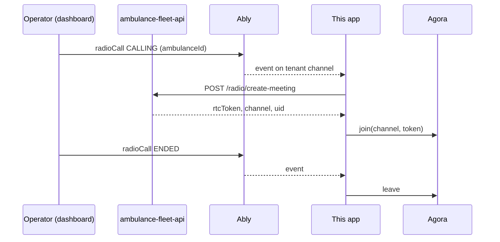

# ambulance-fleet-app

Expo mobile app for ambulance crews and base operators on a multi-tenant fleet management platform: chat, push notifications and push-to-talk radio / public-address calls.

**Status:** prototype, not presented as production. It was built against a backend API that is a sibling repository; see "Known gaps" for what stops it from running standalone.

## What it does

- Sign-in against the REST API with permission-driven route guards (`app/public`, `app/protected`, `src/guards`).
- Onboarding flow for contacts and activities (`src/pages/onboarding`).
- Chat with realtime delivery over Ably (`src/services/use-ably.ts`, `src/pages/chat`).
- Push-to-talk radio and public-address calls over Agora, started by an Ably `radioCall` event (`src/services/use-agora.ts`, `src/hooks/use-radio-call-handler.ts`).
- Foreground service and a background-connection plugin to keep the realtime link alive (`src/services/use-foreground-service.ts`, `src/hooks/use-background-service.ts`).
- Offline message store with expo-sqlite and Drizzle (`src/services/database`, `drizzle/`).
- Error reporting with Sentry (`src/config/sentry.ts`).

## Architecture

System context:



Inside this app:



Radio call flow (callee side):



Boundaries:

- File-based routing with `public` and `protected` groups; guards decide whether a crew may use the app (`src/guards/use-app-guard.ts`).
- All REST calls go through one Axios instance; the client is generated from the API's OpenAPI file.
- Realtime and voice credentials are short-lived and issued by the API; the phone then talks to Ably and Agora directly.
- Vendor SDKs sit behind small hooks (`use-ably`, `use-agora`) so screens do not import them.

## Key engineering decisions and trade-offs

- Contract-first client: `orval.config.ts` reads the API's `swagger.json` and emits typed React Query hooks, so API changes show up as type errors. Trade-off: generated code is not committed and must be regenerated.
- Ably uses token auth with one channel per company group (`connect-<companyGroupId>`, see `src/services/use-ably.ts`); no long-lived Ably key ships in the bundle.
- Radio is event-driven: an Ably event triggers an RTC token request and an Agora join (`src/hooks/use-radio-call-handler.ts`).
- Environment validated at boot with zod (`src/env/index.ts`); the app refuses to start on missing variables.
- Offline-capable message store with checked-in Drizzle migrations (`drizzle/`, `src/services/database/database-schema.ts`).
- Native modules (Agora, background service) require a development build; Expo Go is not enough.

## Tech stack

Expo 54, React Native 0.81, expo-router, NativeWind, TanStack Query, Orval, Axios, Ably, react-native-agora, expo-sqlite + Drizzle, Sentry, zod.

## Getting started

Prerequisites: Node 20+, Yarn, Android Studio or Xcode, the API repository checked out next to this one.

```bash
cp .env.example .env     # fill placeholders
yarn install
npx orval                # generates src/http/generated from the API swagger.json
npx expo run:android     # or run:ios
```

| Variable | Purpose |
| --- | --- |
| `EXPO_PUBLIC_BACKEND` | Base URL of the REST API |
| `EXPO_PUBLIC_STORAGE_URL` | Public base URL of the object storage |
| `EXPO_PUBLIC_APP_VERSION` | Version string shown and sent by the app |
| `EXPO_PUBLIC_SENTRY` | Sentry DSN |
| `EXPO_PUBLIC_AGORA_APP_ID` | Agora project identifier |

`orval.config.ts` still points at an old sibling folder name (`../connect-server-refactor/swagger.json`); change it to your API checkout's `swagger.json`.

## Known gaps

- No automated tests and no CI.
- `package.json` points `expo-background-connection-plugin` at a local filesystem path outside this repository, so `yarn install` fails until it is replaced.
- The app depends on API routes (`/radio/ably-token`, `/radio/create-meeting`) that must be served by your API checkout.

## Testing

None yet. Lint with `yarn lint`.

## Project structure

```text
app/        expo-router screens (public, protected)
src/        components, hooks, services (Ably, Agora, database), pages, guards, lib
drizzle/    SQLite migrations
assets/     images and fonts
```

## Related repositories

- [ambulance-fleet-api](https://github.com/mkwitko/ambulance-fleet-api): REST API
- [ambulance-fleet-dashboard](https://github.com/mkwitko/ambulance-fleet-dashboard): operator web console
- [ambulance-fleet-comms](https://github.com/mkwitko/ambulance-fleet-comms): dispatch communications app
- [ambulance-fleet-driver](https://github.com/mkwitko/ambulance-fleet-driver): driver app

## License

All rights reserved. Source available for portfolio review.
